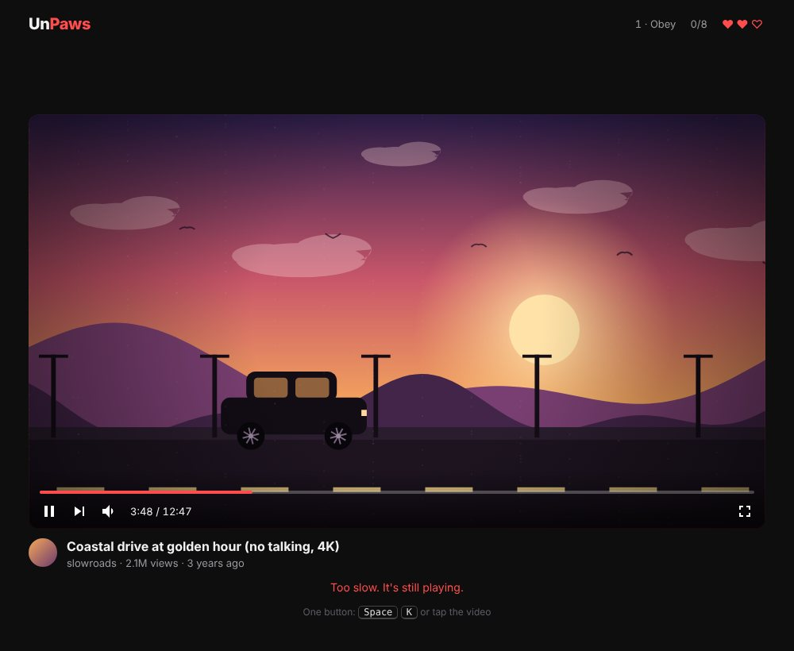
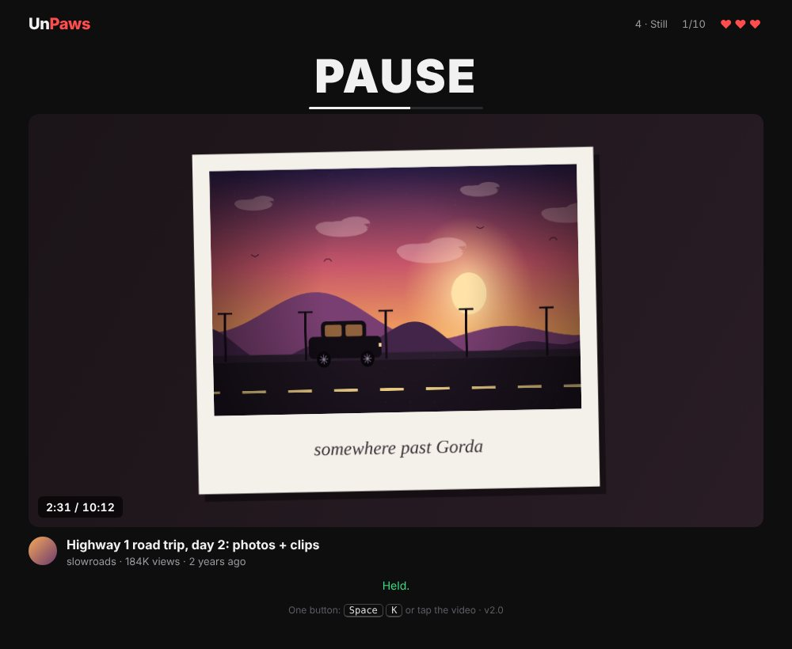

# UnPaws

*A simple-looking, mind-bending experience.*

One button. A video. A command that tells you what the video should be doing.
Make it so, and only press when pressing is the answer.


## Play

Open `index.html` in any modern browser, on desktop or phone. No install, no internet needed, no build step.
If GitHub Pages is enabled for this repository, it's also playable at the repository's Pages address.

- **Space**, **K**, a click on the feed, or the green **ACTUATE** key toggles play and pause.
- The **COMMAND** box tells you how the feed should end up. If it's already there, do nothing.
- Some things on the screen are honest. Some are not. Work out which.

Look closer than the score.

## How it's made

- **One HTML file, no assets, no libraries.** Every frame of every "video" is drawn live on a canvas from a single playback clock, so motion, timing and pauses are exact.
- **Real camera models.** Scenes are placed in metres and projected through a camera with a height and a pitch, so waves, umbrellas, blankets and plates sit and move correctly.
- **Correct forms first, loss from the tape.** Each scene is drawn cleanly at full resolution, then pushed through a tape stage: downsampled to 320×180, colour bleed, line noise, handheld shake, exposure pumping, highlight bloom, interlace and a burned-in date. Pausing behaves like a real VCR.
- **An industrial operator panel.** The interface is modelled on old factory control screens (a fictional vendor, KORTEX): bevelled grey, a yellow alarm line, green LCD readouts, an event log and F-keys. Techy, statistical, never quite polished.

### Design principles
- **The clock never lies.** Something on screen always tells the truth about playback.
- **Every trick must be fair in hindsight.** If you were fooled, there was a clue you could have used.
- **Realistic over arbitrary.** Confusion comes from things real players and real tapes do, never from fake or broken UI.
- **Learn, then unlearn.** The game teaches you what to trust, and then tests it.
- **Feeling first, then aesthetic.**

## The process

UnPaws changed drastically along the way. A few stops:

| | |
|---|---|
|  | **v1.0.** The first playable: a video platform, a drawn coastal drive, one button. |
|  | **v2.0.** The clock becomes honest; still frames that belong in the video. |
|  | **The camcorder.** Low-res home video, never cartoon. |
|  | **Concept tapes.** Sunny days and darker memories, each built around a feeling. |
|  | **Correct forms, loss from the tape.** Left: the clean drawing. Right: what the tape does to it. |
|  | **v3.1.** The same panel, on the terminal in your hand. |

Early mood board: three directions for the outside (80s VHS, vaporwave OS, 70s console).


Every iteration is in the commit history, and the history has its own story. Read it from the beginning:

```
git log --reverse
```

## Feedback

Open an issue, or write to peppermint.candy@proton.me.
