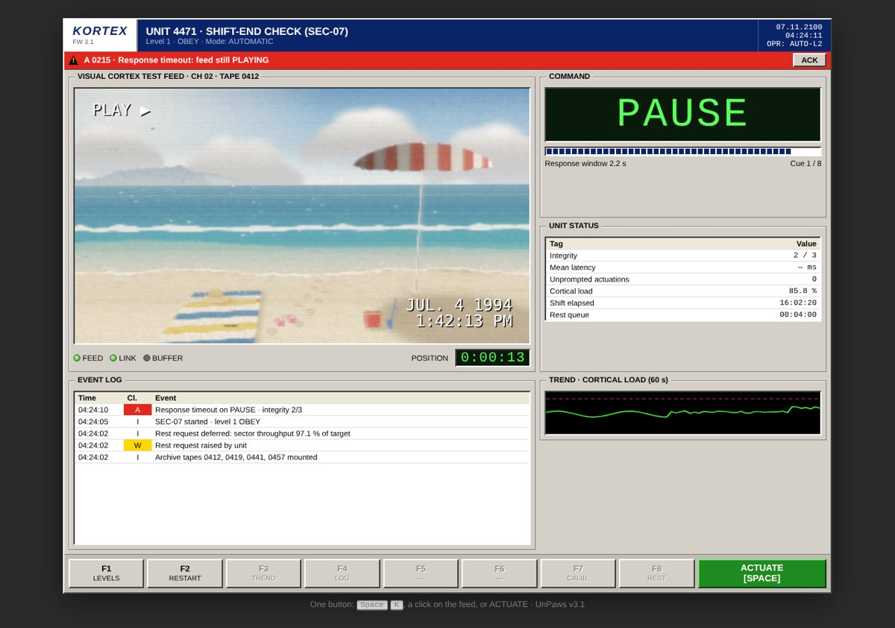
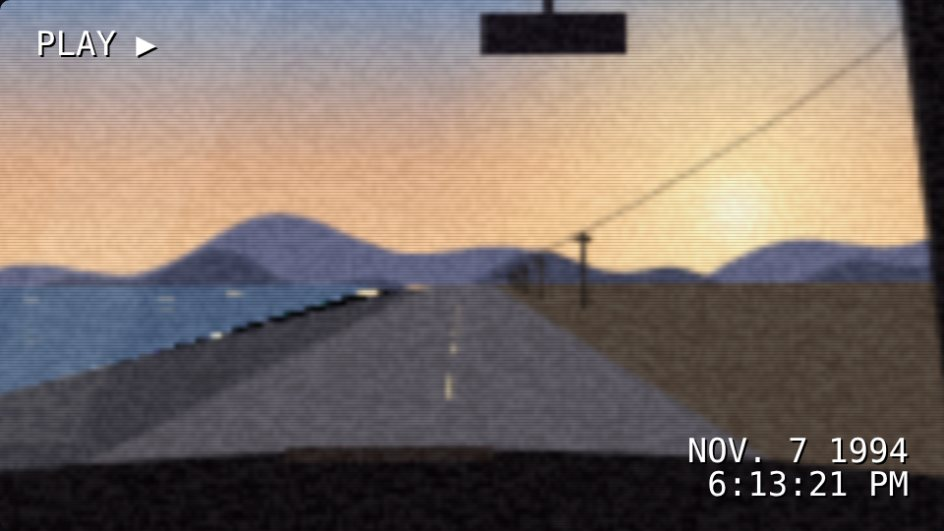
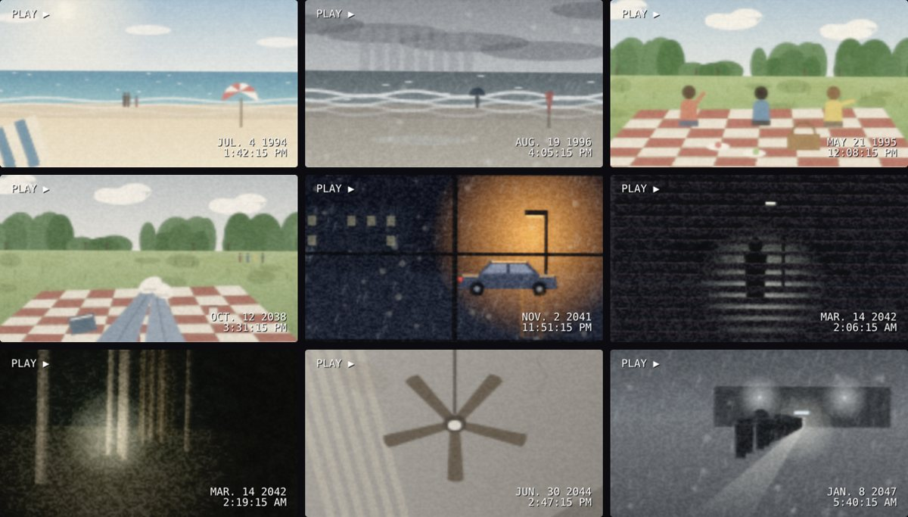
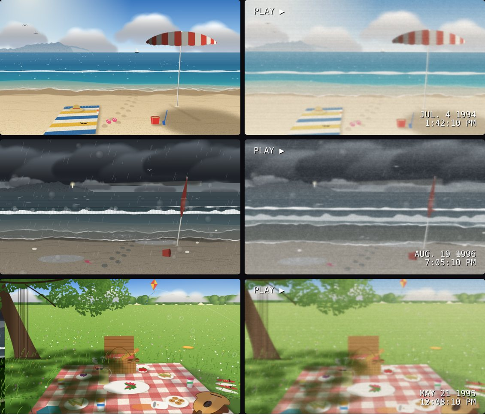
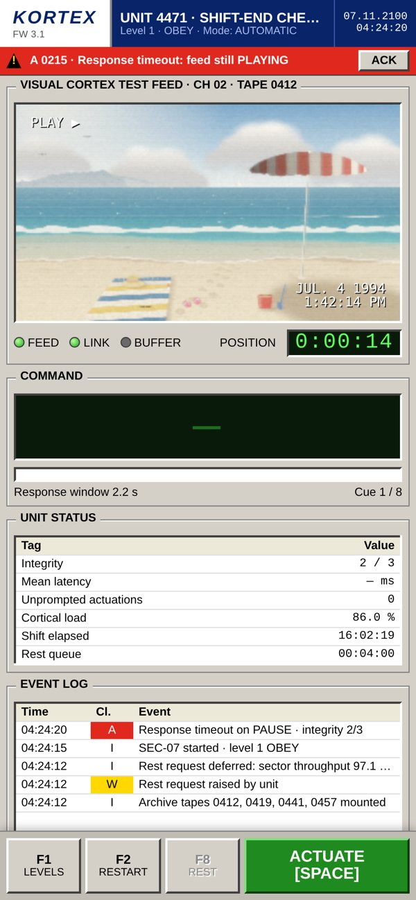
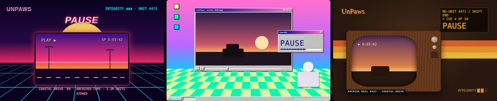

# UnPaws

**Pass the test. Then you may *head out*.**

One button. A tape playing on an operator panel. A command that tells you how the tape should end up.
Make it so, and only press when pressing is the answer.

It starts simple. Then the tape stalls, holds still, rolls with noise, and the commands get wordy.
Easy to understand. Harder to do, stage after stage.



## Play

Play it at **https://yashshiroya.github.io/kortex/**, or open `index.html` in any modern browser, on desktop or phone. No install, no internet needed.

- **Space**, **K**, a click on the feed, or the green **ACTUATE** key toggles play and pause.
- The **COMMAND** box tells you how the feed should end up. If it's already there, do nothing.

Look closer than the score.

## How it's made

- **Drawn live, from one clock.** Every frame of every "tape" is drawn on a canvas from a single playback clock, so motion, timing and pauses are exact. No video files.
- **Real camera models.** Scenes are placed in metres and projected through a camera with a height and a pitch, so waves, umbrellas, blankets and plates sit and move correctly.
- **Correct forms first, loss from the tape.** Each scene is drawn cleanly at full resolution, then pushed through a tape stage: downsampled to 320×180, colour bleed, line noise, handheld shake, exposure pumping, highlight bloom, interlace and a burned-in date.
- **An industrial operator panel.** The interface is modelled on old factory control screens (a fictional vendor, KORTEX): bevelled grey, a yellow alarm line, green LCD readouts, an event log and F-keys. Techy, statistical, never quite polished.

### Principles
- **The clock never lies.**
- **Every trick is fair in hindsight.**
- **Realistic over arbitrary.** Never fake or broken UI.
- **Feeling first, then aesthetic.**

## The look

| | |
|---|---|
|  | **The camcorder.** Low-res home video, never cartoon. |
|  | **Concept tapes.** Sunny days and darker memories, each built around a feeling. |
|  | **Correct forms, loss from the tape.** Left: the clean drawing. Right: what the tape does to it. |
|  | **The same panel, on the terminal in your hand.** |

Early mood board: three directions for the outside (80s VHS, vaporwave OS, 70s console).



Every step is in the commit history, and the history has its own story. Read it from the beginning:

```
git log --reverse
```

## Feedback

Open an issue, or write to peppermint.candy@proton.me.
